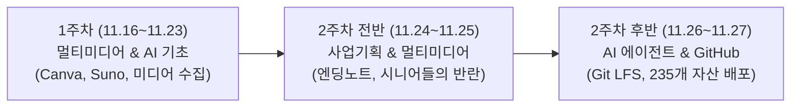

# 🎓 [종합 학습 결과보고서] AI 에이전트 기반 비즈니스 기획·멀티미디어 제작 및 GitHub 형상관리 실습

> **"단순한 AI 질문-답변을 넘어, 기획·문서·영상·클라우드 배포까지 완성하는 1인 풀사이클 AI 크리에이터로의 도약"**

---

## 📌 1. 교육 과정 개요

| 항목 | 상세 내용 |
| :--- | :--- |
| **과정명** | **AI 에이전트 기반 실무 역량 강화 및 워크스페이스 구축 과정** |
| **교육 기관** | 한국폴리텍대학 / Workbox Class (마이웨이 아카데미) |
| **지도 교수** | **유정근 교수** |
| **학습자 (조장)** | **조기한 (CHOKIHAN / 갈매기 5형제 조장)** |
| **교육 기간** | 2026년 11월 16일 ~ 11월 27일 (2주간 집중 실습) |
| **최종 저장소** | [https://github.com/choki599-art/-](https://github.com/choki599-art/-) (총 235개 산출물 등재) |

---

## 🧭 2. 주차별 학습 로드맵 및 핵심 습득 역량

### 🔹 [1단계] AI 멀티미디어 기초 및 창작 도구 활용 (11.16 ~ 11.23)
* **Canva 디자인 실습**: 카드뉴스, 썸네일, 프레젠테이션 그래픽 기획 및 제작 (`AI공부-Canva에서.mp4`)
* **생성형 AI 음원/음성 제작**:
  * Suno AI 등을 활용하여 직접 작사한 곡 `다시, 교실에서`(발라드 장르) 생성 및 음원 추출
  * 시 낭송, 불조심 홍보 영상용 나레이션 오디오 합성
* **컴퓨터 파일 시스템 기본기**: `hello.txt` 생성, 절대 경로 복사(`Copy Path`), 작업 폴더 관리

---

### 🔹 [2단계] 비즈니스 모델 기획 및 멀티미디어 패키징 (11.24 ~ 11.25)
기획서 작성에 그치지 않고 **기획서(DOCX/MD) ➔ 발표자료(PPTX) ➔ 홍보영상(MP4/자막)**까지 하나의 완성된 비즈니스 패키지로 제작.

#### ① 프로젝트 A: 「엔딩노트 회사 (Ending Note Co.)」
* **슬로건**: *"삶의 마지막을 아름답게 — 자립·생산·상생형 시니어 웰에이징 & 웰다잉 공동체"*
* **주요 내용**: 수동적 요양병원 입소를 탈피하고, 입주자가 자산에 맞춰 주거(아파트/주택)를 선택하며, 학습·공동식사·친환경 농업을 통해 마지막까지 존엄을 지키는 사회적 기업 모델.
* **산출물**:
  * 정식 사업계획서 (`엔딩노트_회사_사업계획서.docx / .md / .pptx`)
  * 1분 나레이션 영상 및 움직이는 감성 자막 영상 (`엔딩노트-움직이는자막.mp4`)
  * 초고화질 종합 영상 (`내가만든 엔딩노트.mp4`, 121MB)

#### ② 프로젝트 B: 「시니어들의 반란 (중년 사회공헌 및 활동 확대)」
* **슬로건**: *"중년을 열정적으로! 폴리텍에서 다시 시작하는 시니어들의 아름다운 도전"*
* **주요 내용**: '갈매기 5형제' 팀원들의 배움과 우정을 담아, 은퇴 시니어의 재교육 및 사회적 일자리 기여 방안을 정부 정책으로 제안.
* **산출물**:
  * 정부 정책 제안서 (`정부제안서_시니어들의_반란.docx / .md`)
  * 정책 심사 발표 자료 (`시니어들의_반란_정부제안_발표자료.pptx`)
  * 폴리텍 눈 오는 캠퍼스 풍경 + 단체 사진을 결합한 15초 감성 홍보 영상

#### ③ 다양한 산업별 IR(투자유치) 제안서 실습
* 미래 모빌리티: `수소와 자율주행 공간의 혁신`, `미래형 플라잉 캠핑카 스타트업 IR`
* 제조·철도·바이오: `K-Rail 회사소개서`, `모바일케어 IR`, `혈관 노폐물 제거장치 특허 IR`

---

### 🔹 [3단계] AI 에이전트(Agent) 협업 및 Git/GitHub 클라우드 형상관리 (11.26 ~ 11.27)
* **AI 코딩 에이전트 제어 규칙 확립**:
  * `Project Rule`의 개념 이해: 최상위 지침 파일(`GEMINI.md`, `CLAUDE.md`, `AGENTS.md`)을 통해 에이전트가 작업자의 작업 원칙과 규정을 우선 준수하도록 훈련
* **Git 로컬 환경 구축 및 권한 설정**:
  * Windows 내 Git 실행 환경 점검 및 사용자 식별 정보 등록 (`CHOKIHAN` / `choki599@naver.com`)
* **GitHub 원격 저장소 연동 및 보안 인증**:
  * 터미널 환경에서의 GUI 팝업 대기 문제를 파악하고, 브라우저 서브에이전트 협업을 통해 **Personal Access Token(PAT)**을 안전하게 발급받아 원격 저장소(`https://github.com/choki599-art/-.git`) 직결 성공
* **대용량 파일(120MB)을 위한 Git LFS 적용**:
  * GitHub의 단일 파일 100MB 업로드 한계벽을 **Git LFS(Large File Storage)** 기법으로 돌파하여 121MB 영상(`내가만든 엔딩노트.mp4`)을 온전히 업로드 성공!
* **총 235개 산출물 100% 클라우드 동기화 완료**.

---

## 📊 3. 수업 산출물 종합 현황표

| 분류 | 주요 포함 파일 | 파일 형식 | 핵심 의의 |
| :--- | :--- | :--- | :--- |
| **비즈니스 기획서** | 정부제안서 시니어들의 반란, 엔딩노트 사업계획서, 모빌리티 IR 등 | DOCX, MD, PDF, HWP | 아이디어를 정부/투자자 관점의 공식 규격 문서로 구조화 |
| **발표 프레젠테이션** | 시니어들의 반란 발표자료, K-Rail, 테스비코리아, 플라잉캠핑카 등 | PPTX | 텍스트 기획서를 설득력 있는 시각 슬라이드로 시각화 |
| **영상 및 미디어** | 엔딩노트 최종 영상(121MB), 홍보영상, 불조심 캠페인, 눈 오는 폴리텍 | MP4, WEBP | AI 나레이션, BGM, 동영상 편집을 결합한 멀티미디어 완성 |
| **음원 및 음악** | `다시, 교실에서`(발라드), 나레이션 녹음본, 임영웅·골든 BGM | MP3, WAV | 기획 영상에 감성을 더하는 배경음악 및 보이스 트랙 |
| **디자인 & 원본 사진** | 갈매기 5형제 사진, 캔바 작업물, 카카오톡 공유 이미지 등 | JPG, PNG | 팀 활동 기록 및 영상·PPT에 활용된 핵심 소스 이미지 |
| **강의 및 복습 노트** | 유정근 교수님 19일·25일·26일 복습노트, 에이전트 규칙 정리 | HWP, TXT | 향후 지속적 복습과 사후 관리를 위한 가이드라인 |

---

## 🌟 4. 총평 및 향후 비전

1. **디지털 격차를 넘어선 AI 파워유저로의 성장**
   * 중년·시니어 세대의 풍부한 인생 경험과 전문성을 생성형 AI 도구와 결합하여, 젊은 실무자 못지않은 속도와 퀄리티로 고난도 사업기획서와 영상 미디어를 완성했습니다.
2. **단순 활용자를 넘어선 '엔지니어링 마인드' 체득**
   * AI에게 단순히 답을 묻는 수준을 넘어, 파일 시스템 제어, 에이전트 지침 부여, 그리고 개발자들의 표준 협업 도구인 **Git/GitHub**까지 직접 활용하여 클라우드에 포트폴리오를 자산화했습니다.
3. **'갈매기 5형제'의 지속적인 협업 플랫폼 구축**
   * 이번에 구축된 GitHub 저장소(`https://github.com/choki599-art/-`)는 일회성 실습으로 끝나지 않고, 앞으로의 활동과 새로운 제안들을 지속적으로 축적해 나가는 디지털 본거지가 될 것입니다.

---
*보고서 작성일: 2026년 11월 27일*  
*작성자: 조기한 (Antigravity AI Agent 협업)*
